# StellarDrive Demo — TF Advanced

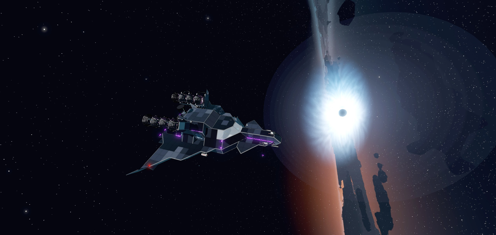

*[Version française](README.md)*

Advanced mods by the TF group for **StellarDrive Demo**, in a single MelonLoader DLL, independent of the `StellarDriveDemoTF` mod.

### Mods to install

| Mod | | Why |
|---|---|---|
| **MelonLoader 0.7.3** | **required** | the game's mod loader |
| **SDModKit** | **required** | without it the mod's parts, item cables and camera do not work (errors and missing parts) |
| **Arsenal** | recommended | the weapons: without it there are no pirates or raids, and force fields do not stop shots |
| TF (`StellarDriveDemoTF`) | optional | if you have it, **version 0.15 or newer** (older ones clash with this mod's TF equipment) |

In multiplayer, every player needs **the same version** of TF Advanced and SDModKit.

What it adds:

- **ship computer** screens showing live data from the game (flight, propulsion, power, diagnostics);
- **engines**: vector thruster, heavy, precision, efficient, exotic matter, nuclear and dark matter engines;
- **power grid**: battery, circuit breaker, quantum reactor, cryonite battery, solar panels;
- **building parts** in wood, glass and iron, beams, plates and frames;
- **space stations** to build: habitation, corridors, hub, stairwell, dome, airlock, docking, laboratory, infirmary, life support, observatory;
- **7 new planets** around Otrera and a **second galaxy, Erebus** (4 planets and an artificial pirate planet, a black hole, wrecks), reached through a **portal**;
- new ores (titanium, quartz, cryonite, amber, **meteorite**, **uranium**), **nuclear power** (centrifuge, reactor, engines) and **dark matter** (collector, reactor, engine, portal);
- **force fields** (six generators), cryonite condenser, quantum gyroscope, **cartography table**;
- a branch of the **research table**, 3 abandoned stations, 3 black holes, asteroid fields;
- **pirates** (with the Arsenal mod): random attacks, pirate bases, the Bastion Écarlate;
- **radars** (1,000 / 5,000 / 20,000 km) showing pirate ships, bases and incoming raids on a round screen, and a **stealth generator** that makes the ship hard to find and to hit (v0.17).

Three build tabs: **TF Avancé**, **TF Construction**, **TF Station**.

**In-game wiki**: open the **Guide** (G key), entry **TF Advanced Wiki** at the top of the list: every planet, its resources and use, machines, building parts, stations, research, with links between pages. The same pages are in [docs/wiki/en](docs/wiki/en/Home.md).

## Pictures

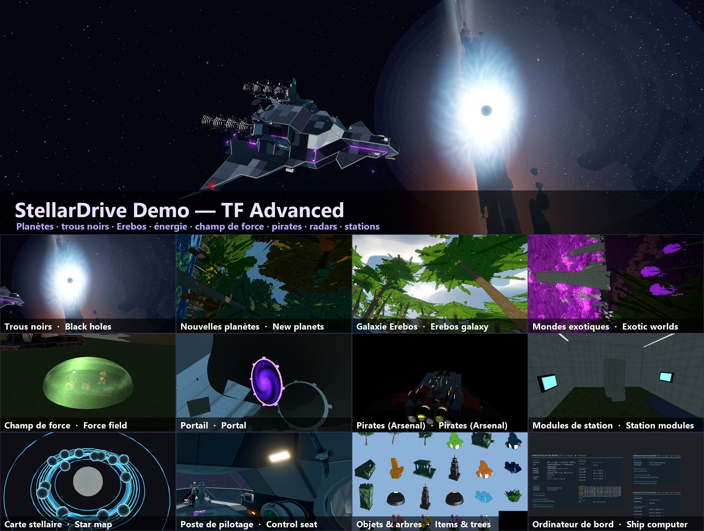

| | | |
|---|---|---|
| 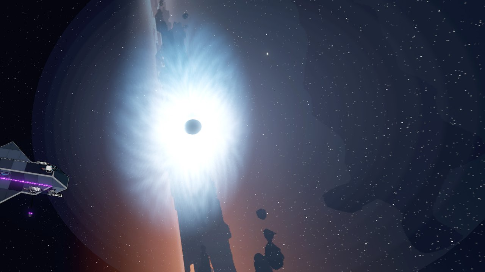<br>Black holes | 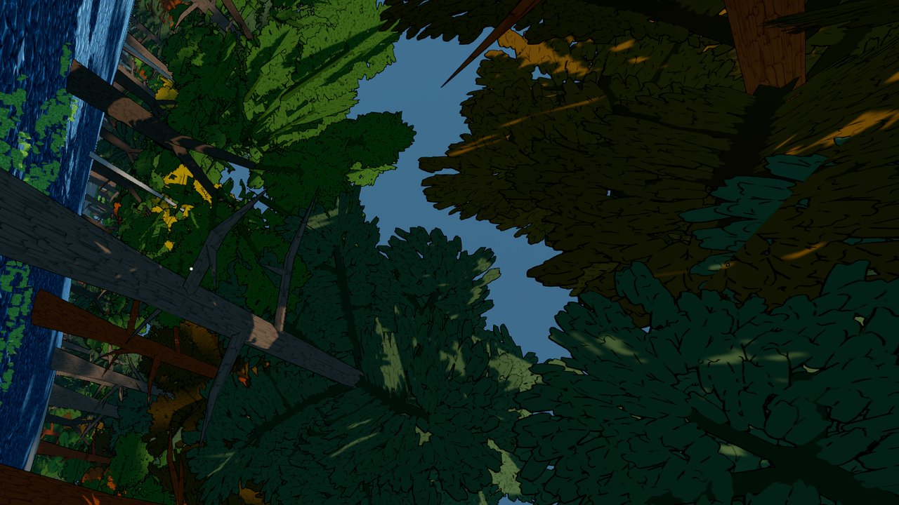<br>New planets | 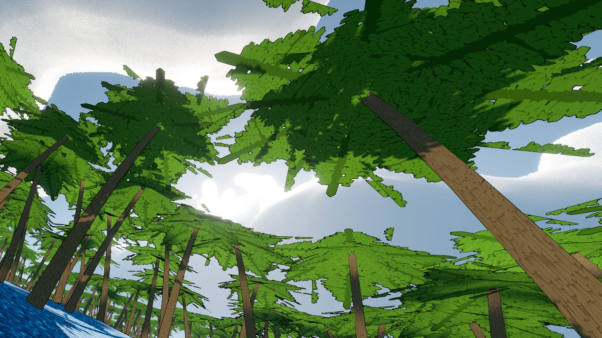<br>Erebus galaxy |
| 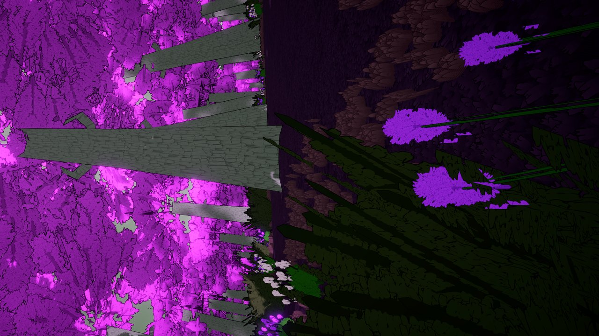<br>Exotic worlds | 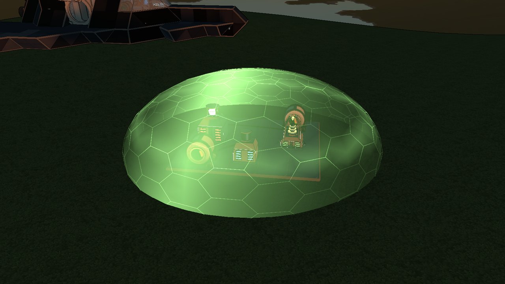<br>Force field | 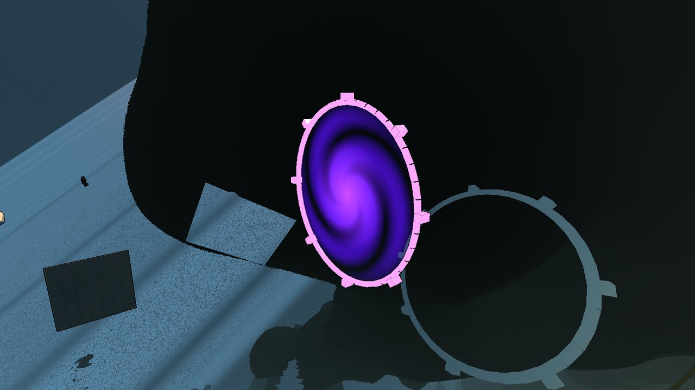<br>Dimensional portal |
| 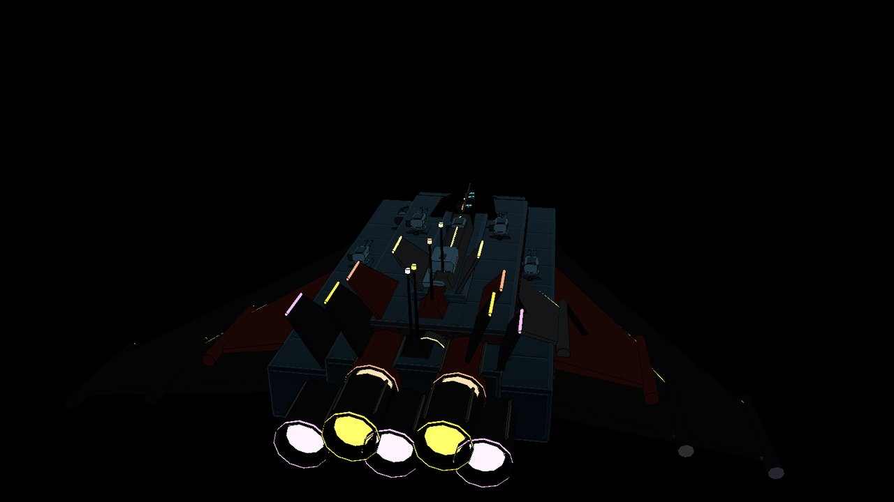<br>Pirates (Arsenal) | 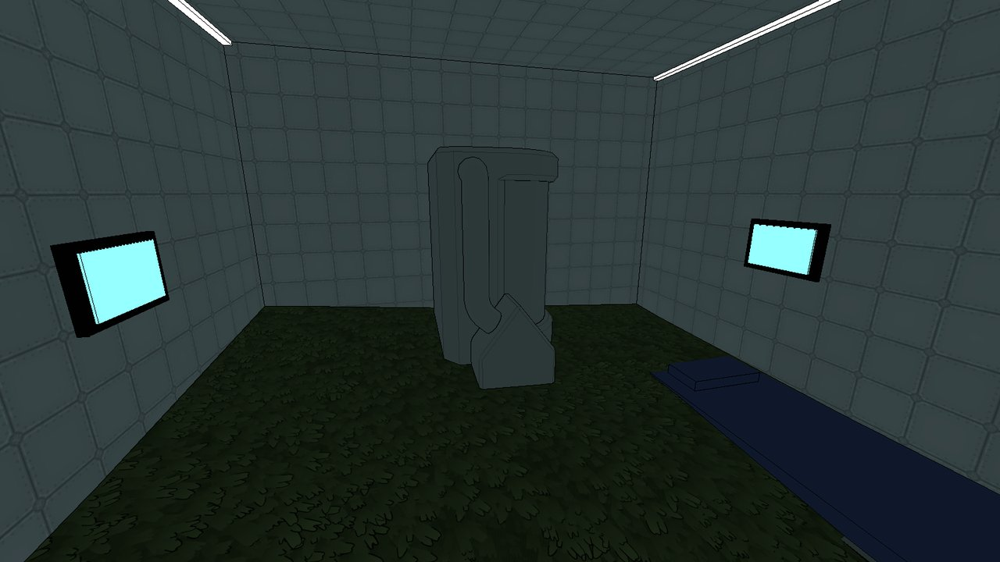<br>Station modules | 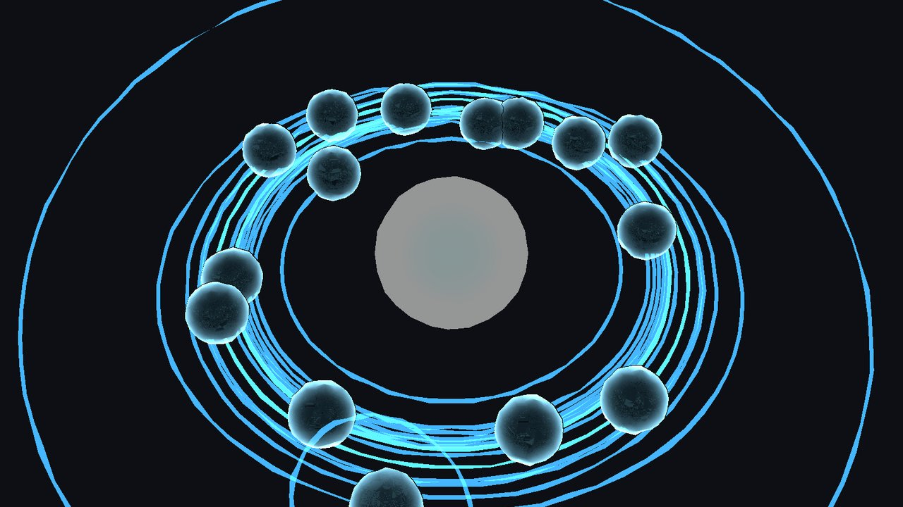<br>Star map |
| 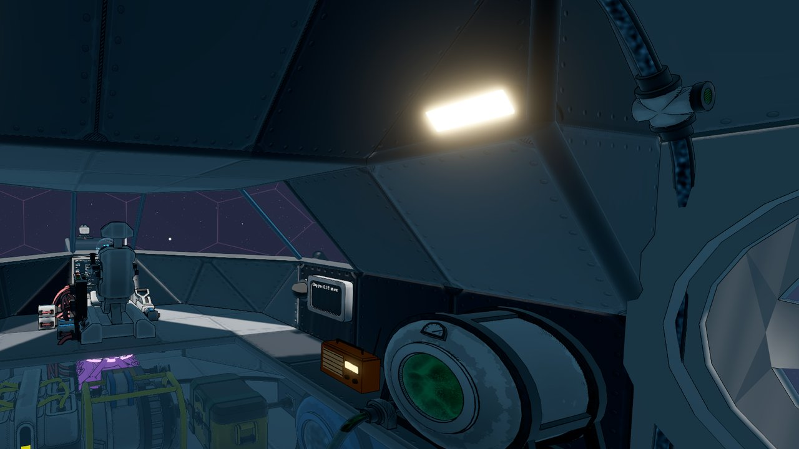<br>Control seat | 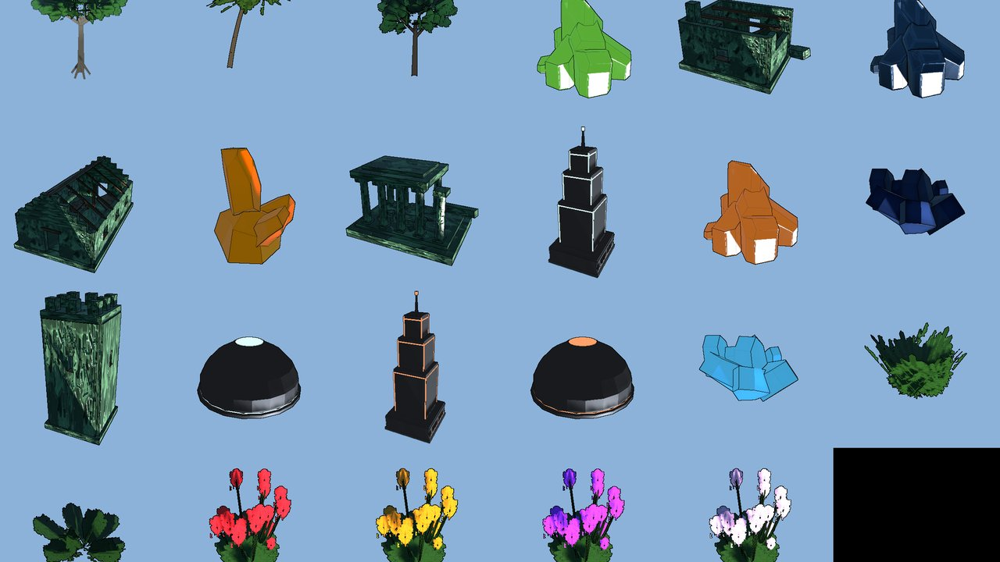<br>Items, ores, trees | 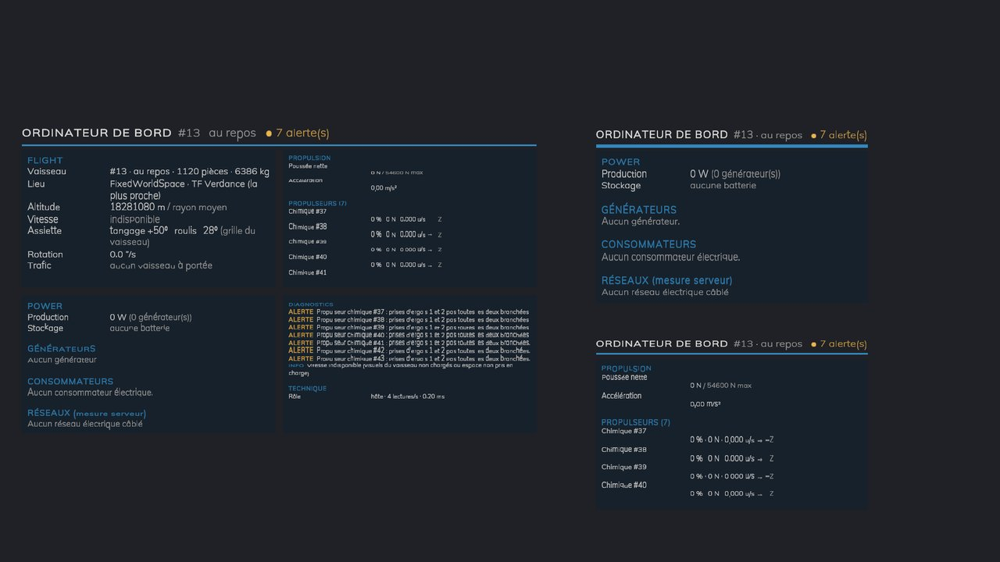<br>Ship computer |

## Blender models, nature scenes (v0.40)

- 3D models are now made in **Blender** (scripts in `tools/blender`, exported and built into the mod): bevelled edges, rounded shapes. First one remade: the **merchant terminal**.
- **Nature scenes** made with **Kenney's Nature Kit** (CC0, www.kenney.nl), recolored to the game's tones:
  - **abandoned camps**: tents, a campfire, logs, a canoe, with a **chest** in the tent;
  - **forest floors**: fallen trunks, stumps, mushroom rings, ferns;
  - **boulder heaps**: tall standing stones, grass on their tops.
- They are on Gaia, Verdance, Sylvara (forest floors) and Altis (boulders). Plants and mushrooms can be walked through, trunks, tents and rocks block.

## Missions, reputation, automatic hangar, auroras, smooth fast flight (v0.39)

- **Today's deliveries** at the merchant terminal: 3 orders a day (e.g. 30 cryonite → 2 quantum cores), once each for everyone, new ones every day.
- **Reputation** with the trader: +1 per pirate ship destroyed, +5 per pirate base, +3 per delivery. Each point lowers his prices by 2% (down to −40%). It is kept with the world.
- **Automatic hangar**: when a ship is docked to the hangar's collar, a force field closes the big door; it opens when the ship lets go.
- **Auroras** at night on TF Glacia and in TF Gaia's cold places (high up, near the poles).
- **Smooth fast flight**: the game made the colliders of the trees and points of interest again around every ship, even high in the sky (about a thousand trees a second at speed). Above 100 m over the ground no trees, above 200 m no points of interest. Over Gaia at 300 m/s: about 53 fps instead of 47. Gaia's secondary forests draw nearer.
- **`LowPerformance`** setting for modest computers: one forest per planet, lighter rain and snow, no auroras.

## Weather, trading station, ship hangar (v0.38)

- **Weather** on the mod's planets when you are outside: rain and **thunderstorms with lightning** (Gaia, Verdance, Sylvara, Thalassa), **snow** (Glacia, and Gaia above the snowline), **sandstorms** (Aridia), **ash and embers** (Pyros). The weather changes every 10 minutes, the same for every player. Setting `Weather` turns it off.
- **Hermès trading post**: a trading station near TF Sylvara (beacon under its name). Its **merchant terminal** (T key) trades your ores for rare finds: quantum core, exotic matter, Nexoran alloy, artifact, gold bars. You can also sell back. The host makes the trade.
- **Ship hangar** (TF Station tab): a 12 × 8 × 20 m module. A whole ship flies in through a 10.8 × 7.2 m door and docks with its docking door to the magnetic collar on the back wall. The Hermès trading post has one, with a merchant terminal inside.

## An Earth-like Gaia, smoothness, fixed stations (v0.37)

- **No more 1 frame per second on Gaia**: its four forests placed trees inside each other; their physics knocked them down as logs, which knocked their neighbours down, in a chain (hundreds per second). On the mod's planets a tree now only falls to a real impact (a ship); the laser and the tools cut it as before.
- **Gaia reworked**: oceans, prairies and temperate woods, savannas, palm coasts, a **taiga** of snowy firs, **tundra** and **snowy mountains**. The snowline follows each region's climate: low in the cold ones, only on the high peaks in the warm ones. More relief.
- **Caves** in the hills (big rock chambers, violet or turquoise crystals) and **ice caves** in the mountains: stalactites, stalagmites, glowing crystals, ore inside (quartz, cryonite).
- **Trees**: leaf cards no longer show a piece of the neighbouring branch (straight edges).
- **Stations**: the wrecks' dressing left an invisible block in the middle of the station; its big pieces now collide (bow, blades, containers, nacelles, nozzles, ring, dish, panels). Furniture no longer blocks the passages between modules or the top of shafts. Stations are rebuilt on load (their contents reset).
- **Optimization**: the teleporter and the schematic tablet searched the whole scene for the tool belt every frame (~3 ms a frame); points of interest keep their placement instead of working it out again.

## Giant wrecks, Hades probe, fitted cosmetics (v0.36)

- **Vagabond wreck**: 60 m heavy freighter, bulkheaded hold, crates, deck containers, crane, glazed bridge, nacelles, torn-off engine section and debris.
- **Leviathan wreck**: 90 m capital ship, dagger bow, armoured blades, dorsal decks, dead turrets, hangar, collapsed bay, bridge, six nozzles.
- **Hades probe** made big: labs, glazed observation deck, spire and observatory, gravimetric ring, large dish, sensor boom, solar wings.
- These three are rebuilt when an older world loads (what was inside is lost).
- **Cosmetics**: the jacket follows the body (real animated mesh), hat and glasses fitted to the helmet; your jacket also shows in first person.
- **Saving**: the mod no longer hooks GameSaver.SaveGame (it listens to the game's save event): no more refusals from mods that guard the save.

## Teleporter (v0.35)

- **Teleporter**: item **7419** with no recipe, given with a give command. Held in the hand, left click: list of **planets** (set down on dry land, day side), **stations** and **beacons** (set down beside the beacon).

## Fixes, signal gear, lumberjack laser (v0.34)

- Build menu **thumbnails**: camera, capsule, radio and rack have their colors again; the cosmetic cabin shows in the TF Equipment tab.
- **Landing gear** driven by a **signal** (lever, pilot seat, advanced control...) on its command socket, no longer by T; unwired it stays out; a socket gives its state.
- **Ship mining laser**: beam centred on the barrel; it also fells **trees** and sends the **wood** to the chest.
- **Force field doors**: the emitter can be painted and taken down with the field on (you still walk over it); the manager makes each door (or all) **solid or walk-through**.
- **Interfaces**: the paint HUD and the camera tablet take the same frame as the other windows.
- **TF Gaïa** moves to the **Erebus** galaxy.

## Landing gear, cosmetic cabin (v0.33)

- Retractable **landing gear** with a shock absorber (TF Advanced tab, propulsion row): fixed under the hull. Out, it carries the ship like a suspension (spring, damper, pads that grip even on a slope); in, it folds against the hull. All gear comes out and goes in together: T on one of them or the L key aboard, when piloting too.
- **Cosmetic cabin** (TF Equipment tab): colors of the suit, helmet, backpack and visor, a hat, sunglasses and lens color, a jacket. A mannequin in the booth wears your outfit, and the other players see you in it in multiplayer.

## TF Gaïa, an Earth-like planet (v0.32)

- **TF Gaïa** (442 Otrera system): oceans and lakes, sand beaches and deserts in the lowlands, flowering prairies above, with forests (firs, oaks, birches), acacia savannas and palm groves each in their own regions, and mountains under snowy firs. Villages, ruins, wrecks; amber, quartz, wood. The game's terrain engine draws three ground textures only (water, sand, grass): the snow is on the trees up high, not on the ground.

## Game-style interface, search, new models (v0.31)

- **Interface**: the mod's windows (doors, radio, rack, capsule, schematics, manager, paint, camera tablet) take the look of StellarDrive's menus: night blue panel, rounded metal frame with yellow and black stripes, blue buttons, the game's font.
- **Search in the build menu**: a bar at the top of the panel; a few letters show the parts of every tab whose name holds them (accents ignored), as the game's buttons.
- **Radio**: new modern model (capsule speaker on a plinth, glass screen with an equalizer moving to the beat, drivers in lit rings, LED strip, antenna fin).
- **Surveillance camera**: new futuristic model (base with a lit ring, yoke, sleek pod, lens in rings with a lit iris, fins, antenna).
- **Optimization**: the "[T] ..." prompt and the tablet's hint no longer create a texture every frame.

## Force field doors, flame, radio (v0.30)

- **Force field door**: color from the paint gun, **negative values** (width → to the other side, height → down from a ceiling), **solid state** (a wall nobody walks through, the air stays in).
- **Force field door manager**: a console showing how many doors are connected to the ship, which ones are up, and switching them on or off (one by one or all).
- **Dark matter engine**: a violet jet turning black.
- **Radio and tool rack** (and other TF objects): lit like the game's parts (no longer standing out, too bright, in a dark ship).
- **Radio**: "Muted for me" per player; the host can block players who may not change the music.

## Force field door: sides, thickness (v0.29)

- **Side**: the field spreads on both sides of the emitter, or only to its left or its right (set it against one side of the opening).
- **Thick** field (20 cm, two faces with lit edges) going **down to the floor**: no more gap at the bottom.
- Field up: the rail has **no collision** any more, you walk over it without bumping.

## Force field door (v0.28)

- **Force field door** (TF Advanced tab, force field row, Artifact technology research): an emitter rail set on the floor in the middle of an opening in the hull. Use key (T): choose the field's size, from 1 × 1 to 30 × 30 m (2 × 2, 10 × 20...), an orange outline shows it, then switch it on. The field holds the oxygen like a closed door, but you walk through it (a ripple runs from where you cross). 25 W per m²; without power it goes out and the air escapes.

## Portal on the move, teleporter, new models (v0.27)

- **Portal**: no longer closes when the ship gets under way (the game then changes the ship's space; the portal is carried over to the new space, in the same place).
- **Teleport capsule**: you come out in front of the arrival capsule's door, facing out, instead of being pushed out at a side.
- **Dark matter collector**: new model (mast, stator, three-vane rotor, meteorite dish, a singularity in a gimbal) and an animation while it collects: the rotor spins up, the gimbal turns, the singularity throbs, violet streaks swirl into it and everything lights up.
- **Infinite parts**: lighter, more detailed texture and armor of their own (glowing cage on the generator, hoops on the oxygen and ethanol tanks, guards and plate on the chest), with the infinity sign and a crystal.
- **Radio**: new model (bevelled case, round speaker with chrome rings, lit dial with a needle, preset keys, ridged knobs, power light, chrome handle, telescopic antenna).

## Own crafts, new models, loot ping (v0.26)

- **Crafts**: no material from another mod nor aluminium any more. Everything is built from the game's materials (iron, glass, copper, wood, stellar shards) and the mod's (titanium, uranium, meteorite…).
- **New 3D models**: exotic matter engine (crystals in a field cage, petal nozzle), nuclear fuel, dark matter and infinite dark matter tanks (glowing hoops, shield plate, hatch, emblem).
- **Cartography table**: more detailed model, animated hologram (sweep, scan wave, spinning rings) and an easier-to-read page on a dark panel.
- **Loot ping**: when a pirate ship is destroyed, a marker on screen shows its loot capsule for 10 minutes (`LootPingMinutes` setting).

## Reinforced hull, ship mining laser (v0.25)

- **Reinforced hull** (*TF Blindage* tab): the game's iron and glass floors, plates, corners and slopes, reinforced. Same model, a slightly darker shade, real airtight hull. 3 times tougher in collisions; with Arsenal, a third of the damage and no holes. 1.5 times heavier.
- **Ship mining laser**: the player's mining laser on a turret that bolts to the hull. Its beam (40 m) mines rocks, crystals and asteroid ores, 3 times faster than the tool, and puts what it mines into the chest linked to its item socket by an item line. 800 W, command and status sockets.

## Stations you can enter, pirate fortress chests (v0.24)

- **Stations and wrecks you can enter**: their entrance is now one of the game's docking doors, open: dock with your ship's docking door, or float in. Stations already in your worlds are rebuilt with their door when the world loads (a destroyed pirate base stays a wreck).
- **More realistic stations**: ceiling lights, lit strips in corridors, a console, a star map, a research table, shelves, supply crates besides the chests; outside, a truss mast, solar panels along the corridors, antennas and blinking beacons.
- **Chests in the Bastion's pirate fortress**: towers and domes hide the pirates' plunder (alloy, titanium, uranium, meteorite, quantum cores, gold).

## Paint gun, rack fixed, new capsule (v0.23)

- **The TF mod's paint gun**: without the TF mod, TF Advanced provides it. It also paints doors, machines and placed parts, with finishes, presets and camouflage; the colors you already laid (`tf-paint.json`) come back, and schematics copy the paint.
- **Tool rack**: gives the paint gun and the tablet, and tells you when you already have it (before, it silently gave nothing).
- **Teleport capsule remade**: a pad with a turning emitter, profiled pillars, a lit back wall, an emitter roof, a console; animated energy rings, a light column and rising sparks, brighter with someone inside and on departure.

## Ships turn without jerks (v0.22)

- **Jerky turns fixed**: with vertical sync on a fast screen (165 Hz) and the game around 60 fps, frames stayed on screen 2 then 3 refreshes (12 then 18 ms): a ship turning steadily moved by small then big steps. When the game can't keep up with the screen, every frame now waits the same number of refreshes (a steady 55 fps on 165 Hz). Every 45 s it checks whether the game got fast enough again. Never under 45 fps, nothing without vertical sync; setting `SteadyFrameRate`.

## Schematic tablet, third person, lighter portal, new radars (v0.21)

- **Schematic tablet and third person view** (from the TF mod): without the TF mod, TF Advanced provides them. Same tablet (item 7201), same schematics (`UserData/TF/schematics`), key **V** while piloting. The tablet comes from the tool rack. KeySeat seat keys are kept and copied by schematics.
- **Portal**: it draws 8,000 W instead of 20,000 (an infinite generator gives 20,000: it stalled as soon as another machine drew power) and burns 3 dark matter instead of 5. Short of power, it charges slower instead of stopping. Settings left at the old values move to the new ones.
- **Radars remade**: a sweeping bar antenna for short range, a dish on a tripod with a counterweight for long range, a lit phased array panel for deep space; braced mast, lit bearing, screen visor, status lights.

## Tougher pirates the farther you go, new portal (v0.20)

**Danger grows with distance**: near the home planet, only scouts, one or two at a time, and less often. One danger level more every 5 million km (setting `PirateDangerStepKm`): corsairs and hornets around TF Aridia, raiders and lancers around TF Verdance and TF Glacia, escorted cruisers and torpedo boats past TF Nexora, and dreadnoughts in the Erebos galaxy.

**Four new pirates**, armed with the Arsenal weapons they did not use yet:
- **Hornet** (level 2): yellow with black stripes, the fastest, looses 9 rockets in a row;
- **Lancer** (level 3): railgun and two ion cannons that jam your weapons, fires from afar;
- **Torpedo boat** (level 4): two torpedo launchers, a SAM battery and a point defense;
- **Dreadnought** (level 5, Erebos only): 14,000 hull points, 14 weapons, command tower.

Each has its own fairing. Pirate bases now launch hornets too.

**Dimensional portal reworked**: the generator has a ring in sections with glowing seams and two gimbal rings turning like a gyroscope around a floating crystal, faster and faster while it charges. The portal opens in steps: sixteen segments fly in and lock with a flash, then the horizon opens with two swirls turning against each other, ripples, sparks drawn in, a rune ring and a violet light. When it closes it collapses into a flash, even after the ship has gone through.

## Spanish, full translation (v0.19)

The mod now speaks **Spanish**: setting `Language = "es"` (or `auto` with the game in Spanish). Parts, machines, research, ship computer screens, radars, planets, cartography table and the **in-game wiki** (27 pages) are translated. The TF equipment (lamps, camera and tablet, capsule, radio, tool rack, infinite parts), French only since it came from the TF mod, now speaks French, English and Spanish.

**Lamps**: the `[TFAdvancedObjects]` settings were never loaded since v0.18. Every lamp threw an error each frame (thousands a minute, lower FPS), and the tablet, radio and use key could not read their settings. Fixed.

## TF equipment and stability (v0.18)

The TF mod's **lamps, camera and its tablet, teleport capsule, radio, tool rack and infinite parts** are now in TF Advanced (tab **TF Équipement**, same part numbers: what is built stays). Infinite parts are now **extremely expensive**. The TF mod 0.15 leaves them to it. Details: [wiki, TF equipment](docs/wiki/en/Equipement-TF.md).

**Shaking ship**: the quantum gyroscope (torque x5) made the ship oscillate at every physics step as soon as it turned, and after (the game's gyroscope controller asked it for 5 times too much). It now knows its strength: no more oscillation, and from 47-55 to 65-70 FPS while turning a big ship. Also: no more thousands of "NetworkManager not found" messages in the menu (TF Advanced and TF), the force field bubble and the cartography table no longer walk the whole ship or scene every 2-3 s.

## Language

The mod speaks **English**, **French** and **Spanish**. Setting `Language` (section `[TFAdvanced]` of `UserData/MelonPreferences.cfg`):

| Value | Language |
|---|---|
| `auto` (default) | the game's language; French or Spanish if the game is in French or Spanish, English otherwise |
| `en` | English |
| `fr` | French |
| `es` | Spanish |

Part names and descriptions are read at start-up: restart the game after changing it. The in-game wiki follows the setting at once. Names saved in a world (station beacons, planets) keep their original French names so that every player of a world sees the same names.

## Installation

**With StellarModManager**: download "StellarDrive Demo TF Advanced", then "Install in game".

**By hand**:
1. MelonLoader 0.7.3 and **SDModKit** installed in the game.
2. Download `StellarDrive-demo-TF-advanced.zip` from the [latest release](https://github.com/Romalaure/StellarDrive-demo-TF-advanced/releases/latest).
3. Copy `Mods/StellarDriveDemoTFAdvanced.dll` from the zip into `StellarDrive Demo/Mods/`.

In multiplayer, **every player** needs the mod: physics runs on the host, and the parts must exist for everyone. A world saved with these parts still loads without the mod: the game skips unknown parts.

Optional: the **Arsenal** mod (weapons) enables pirates and lets force fields stop weapons.

## Getting started

1. Go to **TF Verdance**: wood, amber, village chests. Research *Carpentry* and *Metal construction*.
2. **TF Altis** or **TF Petra** for titanium, Petra for the first meteorites (no air there).
3. **TF Glacia** for cryonite: cryonite battery, condenser, force field.
4. **TF Nexora** for quantum cores and alloy: quantum reactor.
5. Research *Dark matter*, then *Dimensional portal*, and open a portal to **Erebus**.

The [suggested route](docs/wiki/en/Itineraire.md) and the [planets](docs/wiki/en/Home.md) pages have the details.

## Settings

`UserData/MelonPreferences.cfg`, section `[TFAdvanced]`:

| Key | Default | Role |
|---|---|---|
| `Language` | `auto` | language of the mod's texts: `auto`, `en` or `fr` |
| `ComputerRefreshRate` | `4` | screen refreshes per second (1-20) |
| `ComputerViewDistance` | `40` | beyond this (m), a screen stops refreshing |
| `TrafficRange` | `3000` | range of the traffic list (m) |
| `NewPlanets` | `true` | the new planets |
| `Erebos` | `true` | the Erebus galaxy (needs `NewPlanets`) |
| `BlackHole` | `true` | the black holes |
| `AbandonedStations` | `true` | creates the abandoned stations in a world that does not have them yet |
| `ResearchUnlocks` | `true` | the mod's parts are unlocked at the research table (`false`: all available at once) |
| `EngineSeatControl` | `true` | nuclear and dark matter engines obey the pilot seat (`false`: they push as soon as they are fed) |
| `PirateRaidStartKm` / `PirateApproachKmPerSecond` | `25000` / `250` | where a pirate raid is spotted (km) and how fast it closes in (km/s) |
| `RadarAlarm` | `true` | on-screen alert when a radar near you sees a raid coming |
| `SteadyFrameRate` | `true` | vertical sync on and game slower than the screen: same number of refreshes for every frame, so turns don't jerk (never under 45 fps) |
| `RadarWatts` / `CloakWatts` (`[TFAdvancedPower]`) | `400` / `6000` | power of the short range radar (x3 long range, x8 deep space) and of the stealth generator |
| `Pirates` / `PirateIntervalMinutes` | `true` / `12` | pirates (with Arsenal) and mean time in space between two attacks (min) |
| `PirateSafeRadiusKm` | `2000` | pirate-free zone around 442 Otrera b (km, 0: none) |
| `TerrainChunkBuffer` | `1.5` | room for terrain chunks on the graphics card, times the game's; above 1, high mountains no longer leave holes in the ground |

Power values (reactors, batteries, force fields, portal…) are in section `[TFAdvancedPower]`. In multiplayer, world settings (planets, galaxy, black holes) must be the same for every player.

## Building

Requirements: .NET SDK 8, the game installed with MelonLoader and SDModKit.

```
dotnet build src/StellarDriveDemoTFAdvanced -c Release
```

The build copies the DLL into the game's `Mods` folder. `tools/package.ps1` builds the release zip.

## Credits

- Nature scenes: **Nature Kit** by Kenney (www.kenney.nl), license CC0.
